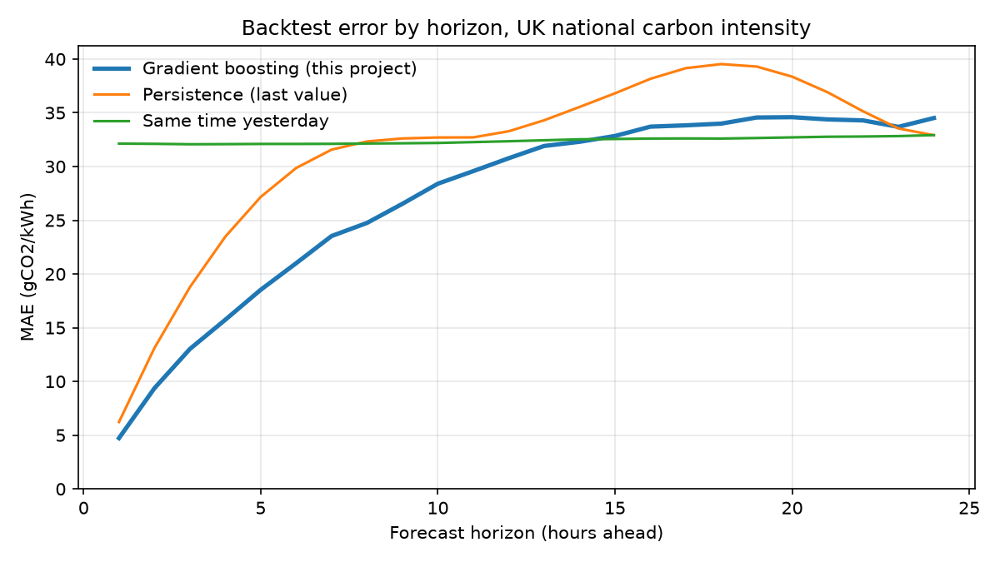
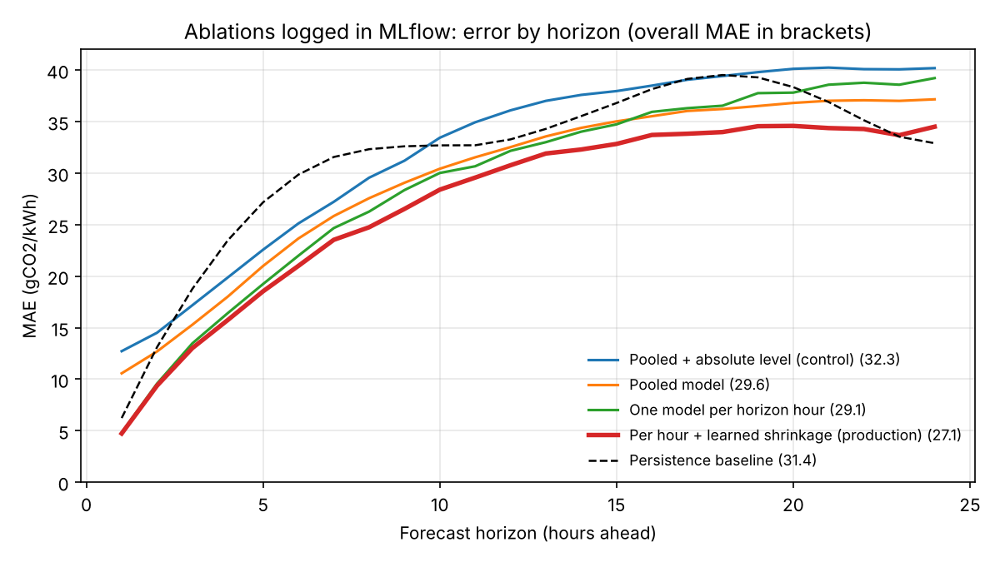

# UK Grid Carbon Intensity Forecaster

Forecasts the carbon intensity of Great Britain's electricity (gCO2/kWh) up to 24 hours ahead, with
calibrated prediction intervals, and serves it as a production API. In a 6-week backtest it beats the best
naive baseline by 13.7% (MAE), and beats both persistence and "same time yesterday" at every horizon up
to 14 hours ahead.

**Live API:** [uk-carbon-forecaster.onrender.com/docs](https://uk-carbon-forecaster.onrender.com/docs) &nbsp;·&nbsp; 

Knowing when the grid will be cleanest lets flexible demand (EV charging, heat pumps, batteries, data
centre workloads) shift to low-carbon periods. The `/forecast` endpoint returns a half-hourly forecast
and the greenest upcoming window.

## Results

Rolling-origin backtest: 6 weekly folds (41,760 forecasts) covering the 6 weeks to 2026-11-20, using 365 days of history. Forecasts are issued hourly for 1–24 hours ahead, and the model is retrained before each fold on past data only.

| Model | MAE (gCO2/kWh) | RMSE | MAPE | Bias |
| --- | --- | --- | --- | --- |
| **Gradient boosting (this project)** | 27.1 | 36.8 | 23.6% | -0.4 |
| Persistence (last value) | 31.4 | 42.5 | 26.9% | -2.2 |
| Same time yesterday | 32.4 | 43.9 | 26.8% | -3.3 |
| Same time last week | 68.2 | 81.7 | 56.6% | -2.3 |

- MAE: 13.7% better than the best naive baseline, persistence (last value).
- RMSE: 13.3% better than the best naive baseline, persistence (last value).
- 80% prediction interval: empirical coverage 77.9%, mean width 83 gCO2/kWh.
- NESO's official forecast: MAE 8.4 on the same periods. This comparison favours NESO, because the API keeps its latest forecast for each period, often issued much closer to delivery than our horizons, and NESO uses weather forecasts that this model does not.



> Generated from `models/metrics.json` by `scripts/update_readme.py`; the same numbers are served live at `/model`.

## Approach

**Data.** Half-hourly national actual intensity from the
[NESO Carbon Intensity API](https://carbon-intensity.github.io/api-definitions/) (CC BY 4.0), fetched in
14-day chunks (the API limit). Gaps of up to 2 hours are interpolated; longer gaps are left missing and
the affected rows are dropped rather than trained on invented values.

**Problem framing.** Direct multi-horizon forecasting: one row per (forecast origin, horizon) and one
gradient-boosting model per horizon hour, so there are no compounding errors as in a recursive forecaster.

**Target.** The change from the latest observed value, not the raw level. Tree ensembles cannot
extrapolate beyond levels seen in training, and the grid keeps decarbonising year on year.

**Features** (all observable at the forecast origin; a unit test perturbs every future value and checks
no feature changes): recent lags, same half-hour yesterday and last week, 3h/24h/7-day rolling means,
all expressed *relative to the latest value*; 24h volatility and change; and calendar features in UK
local time (GMT/BST) including bank holidays. No absolute level and no day-of-year terms (see below).

**Model.** scikit-learn `HistGradientBoostingRegressor`, one per horizon hour. Built-in early stopping is
deliberately off: its validation split is random, and neighbouring (origin, horizon) rows overlap so
heavily that it would validate on near-copies of training rows.

**Shrinkage and uncertainty.** Fitting holds out the most recent 14 days. Models trained without them
are scored on them to learn, per horizon hour, (1) a shrinkage weight in [0, 1] that scales the
predicted change towards "no change" where the model's signal is weak, and (2) split-conformal interval
offsets: the 10th/90th percentiles of the shrunk forecast's errors. The final models are refit on all
data. The learned weights fall from about 0.9 at 1 hour to about 0.03 at 24 hours: without weather
inputs, the model correctly learns it has almost no skill a day ahead and falls back to persistence.

**Evaluation.** Expanding-window backtest against persistence, same-time-yesterday and
same-time-last-week baselines, reporting MAE, RMSE, MAPE, bias, error by horizon and interval coverage.
The API's historical `forecast` field (NESO's own forecast) is also compared, with a caveat: it is the
latest forecast for each period, likely issued much closer to delivery than our horizons, so that
comparison favours NESO.

## Model development

The first version lost to persistence. Each change below was tested with the same 6-fold backtest on
the same year of data:

| Version | MAE | Bias | MAE at 1h | What changed and why |
| --- | --- | --- | --- | --- |
| v1 | 32.1 | −11.4 | 15.3 | One pooled model; absolute levels and day-of-year features |
| v2 | 30.1 | −9.9 | 11.3 | Dropped day-of-year: one year of data can only memorise last year's weather |
| v3 | 29.6 | −1.8 | 10.6 | Level features made relative to the latest value |
| control | 32.4 | −9.7 | 12.8 | v3 with the absolute level added back: the bias returns |
| v4 | 29.1 | −0.4 | 4.8 | One model per horizon hour instead of one pooled model |
| **v5** | **27.1** | **−0.4** | **4.7** | Shrinkage towards persistence learned per horizon on held-out data |

- **The bias (v1 → v3).** Absolute-level features let the trees learn "high values fall", where "high"
  meant above the training year's average (~120 gCO2/kWh). The test weeks ran into November 2026, which
  averaged ~180, so the model kept forecasting a fall that never came. The control row confirms it:
  restoring the absolute level restores the bias.
- **Short horizons (v3 → v4).** At 30 minutes ahead the actual change averaged ~4 gCO2/kWh but the
  pooled model predicted changes of ~12: leaves shared across horizons gave short horizons the large
  changes typical of long ones. Separate models per horizon hour fixed this.
- **Long horizons (v4 → v5).** Beyond ~18 hours the model's predicted changes were mostly noise. The
  learned shrinkage weights handle this automatically instead of a hand-picked cut-off.

## API

| Endpoint | Description |
| --- | --- |
| `GET /forecast?hours=24&window_hours=2` | Half-hourly forecast with 80% intervals, NESO's official forecast alongside, and the lowest-carbon window |
| `GET /model` | Model card: training window, features, backtest metrics |
| `GET /health` | Liveness and model status |
| `GET /docs` | Interactive OpenAPI docs |

Forecasts are cached for 15 minutes. If the upstream API is down the service returns `503` rather than
serving stale or invented data.

## Run locally

```bash
python -m venv .venv && source .venv/bin/activate
pip install -e ".[dev]"
pytest                                                                 # 22 tests, offline
python -m carbon_forecast.train --days 365 --folds 6 --data-csv data/raw.csv   # real data, ~5 min
python scripts/update_readme.py                                        # refresh the Results section
uvicorn carbon_forecast.api:app --reload                               # http://127.0.0.1:8000/docs
```

Offline: `python -m carbon_forecast.train --synthetic --days 90` then `CARBON_SYNTHETIC=1 uvicorn ...`.

## Deployment and MLOps

- **Docker:** the image trains on the latest 365 days at build time, so every deploy ships a fresh model
  with its backtest baked into `/model`. Runs as a non-root user with a container health check.
- **CI (GitHub Actions):** lint (ruff), tests, Docker build with synthetic training, and a smoke test
  that starts the container and calls `/health` and `/forecast`.
- **Hosting:** Render, from `render.yaml`. Auto-deploys on push to `main`.
- **Retraining:** a scheduled workflow triggers a Render redeploy every Monday, which retrains the model
  on the latest data.

## Experiment tracking on Databricks (MLflow)

The `databricks/` notebooks run the same package on Databricks: the data as a Delta table, every
backtest logged as an MLflow run, the best configuration registered in Unity Catalog with a
`champion` alias, and a batch job that forecasts with the champion and scores past forecasts against
actuals. Setup takes about 15 minutes on the free Databricks Free Edition: see
[docs/databricks.md](docs/databricks.md).

| Notebook | What it does |
| --- | --- |
| `00_setup_and_ingest` | Unity Catalog schema and volume, data checks in Spark, Delta table |
| `01_experiments` | Ablation grid and gradient-boosting sweep as nested MLflow runs: params, metrics, MAE at each horizon hour, charts |
| `02_register_champion` | Refits the best run on all data, logs a pyfunc model with signature, registers it, promotes it to `champion` only if it beats the current one |
| `03_batch_forecast` | Forecasts with `@champion`, appends to a Delta table, reports accuracy by horizon and model version |

The ablation grid regenerates the model-development table above as tracked runs (same year of data,
6-fold backtest), instead of numbers copied by hand:

| MLflow run | MAE | Bias | MAE at 1h | 80% interval coverage |
| --- | --- | --- | --- | --- |
| `pooled_with_absolute_level` (control) | 32.28 | −9.65 | 12.72 | 74.3% |
| `pooled_no_shrinkage` (v3) | 29.61 | −1.81 | 10.57 | 79.8% |
| `per_hour_no_shrinkage` (v4) | 29.13 | −0.35 | 4.81 | 78.8% |
| **`per_hour_with_shrinkage` (v5, production)** | **27.11** | **−0.37** | **4.73** | **77.9%** |



The tracking code lives in `src/carbon_forecast/tracking.py` and is tested locally against a SQLite MLflow
store (`pip install -e ".[tracking]"`), so the notebooks stay thin.

<!-- Databricks screenshots: docs/databricks_runs.png (Experiments table), docs/databricks_registry.png (model with champion alias) -->

## Project structure

```
src/carbon_forecast/
  data.py       API client (chunking, retries), cleaning
  features.py   leakage-safe direct multi-horizon features
  model.py      per-horizon gradient boosting, shrinkage, split-conformal intervals
  evaluate.py   rolling-origin backtest and baselines
  train.py      CLI: fetch, backtest, train, save model + metrics + plot
  tracking.py   MLflow: backtest runs, ablation and sweep grids, pyfunc packaging and registration
databricks/     notebooks: Delta ingest, MLflow experiments, Unity Catalog registry, batch forecasts
scripts/
  update_readme.py  rewrites the Results section from models/metrics.json
  api.py        FastAPI service
tests/          data, features (incl. leakage test), model, API, MLflow tracking
```

## Limitations and next steps

- No weather inputs. Wind and solar output drive most variation, which is why skill fades after ~14 hours:
  from there "same time yesterday" is as good or slightly better. Adding wind speed and solar irradiance forecasts
  is the obvious next gain, and would be needed to compete with NESO.
- Intervals slightly under-cover (77.9% for a nominal 80%) because the test weeks were more volatile than
  the calibration window before them.
- Generation-mix data (`/generation` endpoint) as additional features and regional forecasts (`/regional`).
- Intervals assume recent errors resemble future errors; adaptive conformal methods would handle
  regime changes (e.g. a sudden wind drought) better.
- The free Render instance sleeps when idle, so the first request after a pause takes ~30–60 seconds.

## Data attribution

Carbon intensity data © National Energy System Operator (NESO), Carbon Intensity API, licensed under
[CC BY 4.0](https://creativecommons.org/licenses/by/4.0/).
